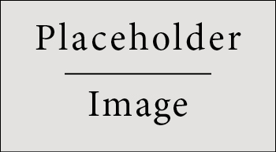

# Part One

\chapterimage{chapter-head-2.pdf}

## Typography and Structure

### A book with a visible hierarchy

The design gives each level of the argument a distinct shape: the part page
opens a movement, the chapter image introduces a subject, and the marginal
section number keeps the page's reading path clear.

The typography follows the original Legrand Orange Book. Headings use a
grotesque face, body text uses a Times-compatible family, and the single orange
accent identifies structure without competing with the prose.

### A small reading sequence

Books are easier to navigate when their structure is repeated consistently.
This example uses parts, chapters, sections and subsections to demonstrate the
complete hierarchy.

1. Open with a part page.
2. Introduce the chapter with a full-width image.
3. Use sections for the argument and subsections for its details.

The same principle applies to lists:

- a bullet marks an unordered set;
- a number marks a sequence;
- a description gives a term its definition.

Term

: A word or phrase whose meaning is being established.

Structure

: The relation between parts that makes the whole intelligible.

### Citations keep the argument connected

Pandoc converts the same Markdown for many output formats [@pandocmanual].
The book's visual identity comes from the LaTeX template, while the citations
come from BibTeX data and the CSL processor.

The LaTeX Companion remains a useful reference for typography and page design
[@latexcompanion]. The orange template itself has a long history in the
Pandoc community [@legrandtemplate].

# Part Two

\chapterimage{chapter-head-1.pdf}

## Mathematical Design

### Theorems

The original template gives mathematical statements a framed, editorial
presence. The orange heading and restrained rule distinguish a theorem from
ordinary prose.

\begin{theorem}[Completeness of the visual hierarchy]
Every distinction in the argument should have exactly one visible level, and
that level should remain consistent throughout the book.
\end{theorem}

### Definitions

\begin{definition}[Reading rhythm]
A reading rhythm is the recurring relation between paragraph width, line
length, vertical space and heading weight.
\end{definition}

### Remarks and corollaries

\begin{remark}
The page should remain legible when the ornamental color is removed. Color
supports the hierarchy; it does not create it.
\end{remark}

\begin{corollary}[Consistency]
A reader who understands the first chapter's visual grammar can predict the
structure of every later chapter.
\end{corollary}

### Propositions and examples

\begin{proposition}
Part pages are navigation, chapter images are orientation, and section numbers
are reference points.
\end{proposition}

\begin{example}[A chapter opening]
A full-width image occupies the top of the page, while a translucent white
panel keeps the chapter title readable over any illustration.
\end{example}

### Presenting information

#### A table

\begin{table}[h]
\centering
\begin{tabular}{l l l}
\toprule
\textbf{Treatment} & \textbf{Response A} & \textbf{Response B}\\
\midrule
Control & 0.0003262 & 0.562\\
Structured & 0.0015681 & 0.910\\
Emphasized & 0.0009271 & 0.296\\
\bottomrule
\end{tabular}
\caption{A compact results table using the book's horizontal rules.}
\end{table}

#### A figure

{width=60%}

#### Code

```python
def chapter_opening(title: str, image: str) -> dict[str, str]:
    return {
        "title": title,
        "image": image,
        "accent": "ocre",
    }
```

#### An admonition

\begin{importantblock}
The orange accent is reserved for orientation, emphasis and mathematical
structure. Reusing it everywhere removes its meaning.
\end{importantblock}

### Exercises and vocabulary

\begin{exercise}
Remove every orange element from two facing pages. Which structural
relationships remain visible, and which depended on color?
\end{exercise}

\begin{problem}
Design a chapter-opening image that remains legible beneath a translucent
title panel.
\end{problem}

\begin{vocabulary}[Accent]
A recurring visual signal that identifies structure without changing the
meaning of the prose.
\end{vocabulary}

### A final cross-reference

Return to [Typography and Structure](#typography-and-structure) to compare the
opening chapter with this one. The template keeps the page grammar stable even
when the subject changes.

\cleardoublepage
\chapter*{References}
\addcontentsline{toc}{chapter}{\textcolor{ocre}{References}}

::: {#refs}
:::
