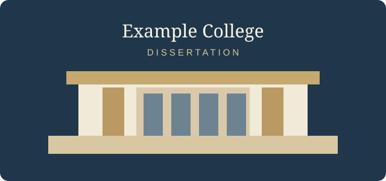

::: {custom-style="TOC Heading"}
Contents
:::

::: {custom-style="TOC 1"}
1\. Introduction
:::

::: {custom-style="TOC 2"}
1.1 Research questions
:::

::: {custom-style="TOC 2"}
1.2 Materials and methods
:::

::: {custom-style="TOC 2"}
1.3 Results
:::

::: {custom-style="TOC 2"}
1.4 Discussion
:::

::: {custom-style="Body Start"}
​
:::

# Introduction

This is the first paragraph of the dissertation body.

This second paragraph demonstrates ordinary body text, **bold**, *italic*,
~~strikethrough~~, `inline code`, [a hyperlink](https://pandoc.org/), H~2~O,
E = mc^2^, [underlined text]{.underline}, and a footnote.[^method]

> A block quotation receives its own academic paragraph style.
>
> Its second paragraph remains part of the quotation.

## Research questions

The study asks how structure, typography and metadata work together.

### Scope

The scope covers headings, lists, figures, tables, notes and references.

#### Method boundaries

The example remains deliberately small while exercising every document feature.

##### Terminology

Terms follow the conventions of document engineering.

###### Conventions

Values shown in the example are illustrative.

####### Extended level seven

Pandoc can represent deeper heading levels in its document model.

######## Extended level eight

These levels are present for completeness.

######### Extended level nine

The final heading level closes the hierarchy.

## Materials and methods

A tight bullet list:

- first item
- second item
  - nested item

An ordered list:

1. prepare the document
2. export it through the reference document

A task list:

- [ ] revise the draft
- [x] inspect the generated styles

A fenced code block:

```python
def cite(source):
    return f"[@{source}]"
```

Inline mathematics such as $E = mc^2$ is carried as an equation.

$$
\int_0^1 x^2\,dx = \frac{1}{3}
$$

A citation such as [@example2026] produces the bibliography entries below.

## Results

| Element | Reference style |
| --- | --- |
| Heading 1 | Chapter |
| Heading 2 | Subheading |
| Table | Academic table |

: Table caption for the dissertation example.

{#fig:dissertation width=4in}

The figure and its caption demonstrate the reference document's visual language.

## Discussion

Term one

: Definition text for the first term.

Term two

: Definition text for the second term.

---

The thematic break separates the closing discussion.

[^method]: A footnote receives the dedicated footnote style.

    A second paragraph demonstrates block text inside the same footnote.

    > A quotation inside a footnote remains part of the note.
